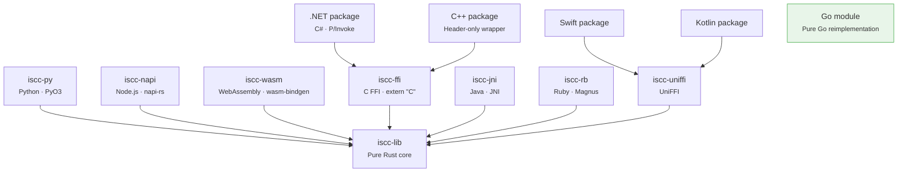

# Architecture

An overview of how iscc-lib is structured — the crate model, module layout, streaming pattern, and
conformance testing approach.

---

## Hub-and-Spoke Crate Model

iscc-lib uses a **hub-and-spoke** architecture. A single pure-Rust core crate (`iscc-lib`) contains
all ISCC algorithms. Each binding crate depends on the core and translates its API to the target
language. The core has no FFI concerns — it publishes to crates.io independently.



The binding crates (Python, Node.js, WASM, C FFI, Java, Ruby, UniFFI) are thin wrappers — they
contain no algorithm logic. The .NET and C++ packages wrap the C FFI, and the Swift and Kotlin
packages wrap the bindings that UniFFI generates from `iscc-uniffi`. The Go module is a standalone
reimplementation of the same algorithms in pure Go. All languages produce identical results for the
same inputs, verified by shared conformance test vectors.

## Workspace Layout

The repository follows kreuzberg's `crates/` directory pattern with centralized dependency
management via `workspace.dependencies` in the root `Cargo.toml`. The tree below is an excerpt: it
shows every crate and package directory, not every file.

```
iscc-lib/
├── Cargo.toml                  # Virtual workspace root
├── Package.swift               # Swift package manifest (SPM entry point)
├── pyproject.toml              # Python project (uv)
├── zensical.toml               # Documentation config
├── mise.toml                   # Tool versions + tasks
├── .pre-commit-config.yaml     # prek hooks
├── docs/                       # Documentation site
├── notes/                      # Architecture notes
├── benchmarks/
│   └── python/                 # Comparative Python benchmarks
├── crates/
│   ├── iscc-lib/               # Core Rust library
│   │   ├── src/                # Algorithm implementations
│   │   └── tests/              # Rust tests + data.json / data-edge.json vectors
│   ├── iscc-py/                # Python bindings (PyO3, maturin)
│   │   ├── src/lib.rs          # PyO3 wrappers
│   │   └── python/iscc_lib/    # Python package + type stubs
│   ├── iscc-napi/              # Node.js bindings (napi-rs)
│   │   ├── src/lib.rs          # napi-rs wrappers
│   │   └── __tests__/          # Node.js conformance tests
│   ├── iscc-wasm/              # WebAssembly bindings (wasm-bindgen)
│   │   ├── src/lib.rs          # wasm-bindgen exports
│   │   └── tests/              # WASM integration tests
│   ├── iscc-ffi/               # C FFI bindings
│   │   ├── src/lib.rs          # extern "C" functions
│   │   ├── include/iscc.h      # Generated C header (cbindgen)
│   │   └── tests/              # C test program
│   ├── iscc-jni/               # Java JNI bindings
│   │   ├── src/lib.rs          # JNI extern "system" functions
│   │   └── java/               # Java package + Maven build + tests
│   ├── iscc-rb/                # Ruby bindings (Magnus, rb-sys)
│   │   ├── src/lib.rs          # Magnus wrappers
│   │   ├── lib/iscc_lib.rb     # Ruby wrapper module
│   │   └── test/               # Minitest suites
│   └── iscc-uniffi/            # UniFFI interface shared by Swift and Kotlin
│       └── src/lib.rs          # UniFFI proc-macro exports
├── packages/
│   ├── cpp/                    # C++17 header-only wrapper over the C FFI + tests
│   ├── dotnet/                 # C# package over the C FFI (Iscc.Lib + Iscc.Lib.Tests)
│   ├── go/                     # Go module (pure Go, no cgo): one file per algorithm + tests
│   ├── kotlin/                 # Kotlin/JVM package over UniFFI (Gradle)
│   └── swift/                  # Swift sources over UniFFI + XCTest suite
└── .github/workflows/
    ├── ci.yml                  # Lint + test every surface
    ├── docs.yml                # Documentation deployment
    └── release.yml             # Build, test and publish to every registry
```

### Crate Summary

| Crate             | Produces                               | Build Tool     | Published To                                                               |
| ----------------- | -------------------------------------- | -------------- | -------------------------------------------------------------------------- |
| `iscc-lib`        | Rust library                           | cargo          | crates.io                                                                  |
| `iscc-py`         | Python wheel                           | maturin + PyO3 | PyPI                                                                       |
| `iscc-napi`       | Native Node.js addon                   | napi-rs        | npm (`@iscc/lib`)                                                          |
| `iscc-wasm`       | WASM package                           | wasm-bindgen   | npm (`@iscc/wasm`)                                                         |
| `iscc-ffi`        | Shared + static library, C header      | cargo          | GitHub Release assets (`iscc-ffi-v<version>-<target>` archives)            |
| `iscc-jni`        | JNI shared library + Java JAR          | cargo + Maven  | Maven Central (`io.iscc:iscc-lib`)                                         |
| `iscc-rb`         | Ruby gem (native extension)            | rb-sys + rake  | RubyGems (`iscc-lib`)                                                      |
| `iscc-uniffi`     | UniFFI library for Swift and Kotlin    | cargo + UniFFI | Not published itself — feeds `packages/swift` and `packages/kotlin`        |
| `packages/cpp`    | C++17 header-only wrapper (`iscc.hpp`) | CMake          | Inside the `iscc-ffi` GitHub Release archives; vcpkg port and Conan recipe |
| `packages/dotnet` | .NET package (P/Invoke over the C FFI) | dotnet         | NuGet (`Iscc.Lib`)                                                         |
| `packages/go`     | Go module                              | go             | pkg.go.dev                                                                 |
| `packages/swift`  | Swift package                          | SwiftPM        | SwiftPM via Git tag, with the XCFramework as a GitHub Release asset        |
| `packages/kotlin` | Kotlin/JVM library                     | Gradle         | Maven Central (`io.iscc:iscc-lib-kotlin`)                                  |

## Internal Module Structure

The `iscc-lib` core crate uses a **tiered API** to control what gets exposed to bindings and
downstream Rust consumers.

### Tier 1 — Stable Public API

Tier 1 is the functions, constants and streaming types that `lib.rs` exports at the crate root,
bound in all languages. Changes require a SemVer MAJOR bump.

- **Code generation:** `gen_meta_code_v0`, `gen_text_code_v0`, `gen_image_code_v0`,
    `gen_audio_code_v0`, `gen_video_code_v0`, `gen_mixed_code_v0`, `gen_data_code_v0`,
    `gen_instance_code_v0`, `gen_iscc_code_v0`, `gen_sum_code_v0`, `gen_iscc_id_v1` (experimental)
- **Text utilities:** `text_clean`, `text_remove_newlines`, `text_trim`, `text_collapse`
- **Algorithm primitives:** `sliding_window`, `alg_minhash_256`, `alg_cdc_chunks`, `alg_simhash`,
    `soft_hash_video_v0`
- **Encoding:** `encode_base64`, `json_to_data_url`
- **Codec:** `iscc_decompose`, `encode_component`, `iscc_decode`, `encode_seq`, `decode_seq`
- **Constants:** `META_TRIM_NAME`, `META_TRIM_DESCRIPTION`, `META_TRIM_META`, `IO_READ_SIZE`,
    `TEXT_NGRAM_SIZE`
- **Streaming:** `DataHasher`, `InstanceHasher`
- **Diagnostics:** `conformance_selftest`

See the [Rust API reference](rust-api.md) for signatures.

Two kinds of crate-root items support Tier 1 but are not counted as Tier 1 symbols:

- **Result structs** (`MetaCodeResult`, `SumCodeResult`, …): the return types of the Tier 1
    functions, defined in `iscc_lib::types` and re-exported at the crate root by `pub use types::*`.
    `iscc_lib::types::X` and `iscc_lib::X` name the same item.
- **`IsccError` and `IsccResult<T>`**: the error every fallible Tier 1 call returns. They live at
    the crate root (`iscc_lib::IsccError`), not in `codec`. Each binding maps them to its own error
    idiom.

`DataHasher` and `InstanceHasher` are Tier 1 crate-root re-exports; their `iscc_lib::streaming::`
paths name the same items. The same holds for the four `codec` functions re-exported at the crate
root (`encode_base64`, `iscc_decompose`, `encode_seq`, `decode_seq`). `codec::encode_component` is a
separate, enum-typed Tier 2 function, not the crate-root `encode_component`.

### Tier 2 — Public Rust API

Public Rust items outside the Tier 1 contract (not bound in every language):

- **`codec` module**: `MainType`, `SubType`, `Version`, header and base32 encoding/decoding, unit
    and length helpers, `read_unit`, `SEQ_MAINTYPES`. These are not exposed through the bindings.
- **`streaming::SumHasher`**: single-pass streaming ISCC-SUM (Data-Code + Instance-Code). Not
    re-exported at the crate root. The Python and WASM bindings wrap it as an extra; the other
    bindings do not.

Tier 2 is part of the public Rust API and falls under the same SemVer contract as Tier 1, checked by
`cargo-semver-checks` (informational until v1.0.0).

### Internal Modules

These modules implement the core algorithms and are `pub(crate)` — never exposed to bindings or
external Rust consumers. Free to change at any time.

| Module    | Purpose                                        |
| --------- | ---------------------------------------------- |
| `cdc`     | Content-Defined Chunking for Data-Code         |
| `dct`     | Discrete Cosine Transform for Image-Code       |
| `minhash` | MinHash algorithm for Text-Code and Data-Code  |
| `simhash` | SimHash algorithm for Meta-Code and Audio-Code |
| `utils`   | Text normalization, hashing helpers            |
| `wtahash` | Winner-Take-All Hash for Video-Code            |

## Streaming Pattern

ISCC operations are **CPU-bound, not I/O-bound** — hashing and chunking are pure computation on byte
slices. The core library takes bytes and leaves file I/O to the caller, with one exception:
`gen_sum_code_v0` takes a file path and reads the file itself.

This drives a key design decision: **the Rust core is synchronous**. Each binding adapts to its
runtime's async model outside the core.

### Core Pattern

Data-Code and Instance-Code support streaming via a three-phase pattern:

```
new() → update(&[u8]) → finalize() → Result<T>
```

This matches the approach used by `std::io::Write` and `blake3::Hasher`. Callers feed data in chunks
of any size, then finalize to get the result.

### Per-Binding Adaptation

| Binding     | Async Strategy                                                                                                   |
| ----------- | ---------------------------------------------------------------------------------------------------------------- |
| **Python**  | Sync API, GIL released during `update()`. Callers use `asyncio.to_thread()` if needed                            |
| **Node.js** | Sync napi-rs exports. `DataHasher`/`InstanceHasher` classes with `update()`/`finalize()`                         |
| **WASM**    | Sync exports — no threading in browser WASM                                                                      |
| **C FFI**   | `iscc_data_hasher_new()` / `_update()` / `_finalize()` / `_free()`, same for `iscc_instance_hasher_*`            |
| **Java**    | Sync JNI API. Static `dataHasher*`/`instanceHasher*` methods on `IsccLib` over an opaque `long` handle           |
| **Go**      | Sync API. `DataHasher`/`InstanceHasher` with `Push([]byte)` / `Finalize(bits)` streaming                         |
| **Ruby**    | Sync API. `IsccLib::DataHasher`/`InstanceHasher` with chainable `update` and `finalize(bits:)`                   |
| **C#**      | Sync API. `IsccDataHasher`/`IsccInstanceHasher` (`IDisposable`, `SafeHandle`) with `Update`/`Finalize`           |
| **C++**     | Sync API. Move-only RAII `iscc::DataHasher`/`InstanceHasher` with `update()`/`finalize()`                        |
| **Swift**   | Sync API. UniFFI `DataHasher`/`InstanceHasher` classes with `update(data:)`/`finalize(bits:)`, freed on `deinit` |
| **Kotlin**  | Sync API. UniFFI `DataHasher`/`InstanceHasher` (`AutoCloseable`) with `update()`/`finalize()`                    |

!!! note "Why not async in the core?"

    Adding `async fn` to the core would force all consumers to bring a runtime (tokio), including WASM
    and C FFI where that makes no sense. There are no awaitable operations — hashing and chunking are
    pure computation. The rule: never expose Rust async across FFI boundaries.

## Conformance Testing

All bindings share the same conformance test vectors — a vendored snapshot of `data.json` from the
official [iscc-core](https://github.com/iscc/iscc-core) Python reference implementation.

### How It Works

1. The canonical `data.json` file lives in `crates/iscc-lib/tests/data.json`
2. The test suites read that file by relative path or `include_str!`; .NET, Swift, Kotlin and Go's
    embedded self-test use vendored copies that `tests/test_vendored_fixtures.py` keeps
    byte-identical. C++ runs the library's built-in `conformance_selftest`, and the C test program
    checks expected values written into the test
3. Test vectors contain inputs and expected outputs for the 9 standard `gen_*_v0` functions
    (iscc-core has no `gen_sum_code_v0`), plus `encode_seq` and `decode_seq`
4. Tests are parametrized — each test case name maps to a key in the JSON

A second fixture, `crates/iscc-lib/tests/data-edge.json`, holds project-owned edge-case vectors that
every surface runs too.

### Cross-Language Test Matrix

| Language | Test Runner                 | Vector Access                                                                        |
| -------- | --------------------------- | ------------------------------------------------------------------------------------ |
| Rust     | `cargo test`                | `include_str!` at compile time (`data-edge.json` read at runtime)                    |
| Python   | pytest                      | Relative path from test file                                                         |
| Node.js  | `node:test` (`npm test`)    | Relative path from `__tests__/`                                                      |
| WASM     | `wasm-pack test --node`     | `include_str!` (no filesystem)                                                       |
| C        | gcc + test program          | Expected values in the test; `data-edge.json` via generated `data_edge_vectors.h`    |
| C++      | CMake + test program (ASAN) | Library `conformance_selftest`; `data-edge.json` via generated `data_edge_vectors.h` |
| Java     | `mvn test`                  | Relative path from the Maven project                                                 |
| Go       | `go test`                   | Relative path to `crates/iscc-lib/tests/`; vendored `testdata/` copies               |
| Ruby     | `rake test` (Minitest)      | Relative path from test file                                                         |
| C#       | `dotnet test` (xUnit)       | Vendored copies in `Iscc.Lib.Tests/testdata/`                                        |
| Swift    | `swift test` (XCTest)       | Vendored copies bundled as SwiftPM test resources                                    |
| Kotlin   | `./gradlew test`            | Vendored copies on the test classpath (`src/test/resources/`)                        |

This approach catches cross-language drift — encoding differences, rounding behavior, default
parameter mismatches — immediately when any binding diverges from the reference.
